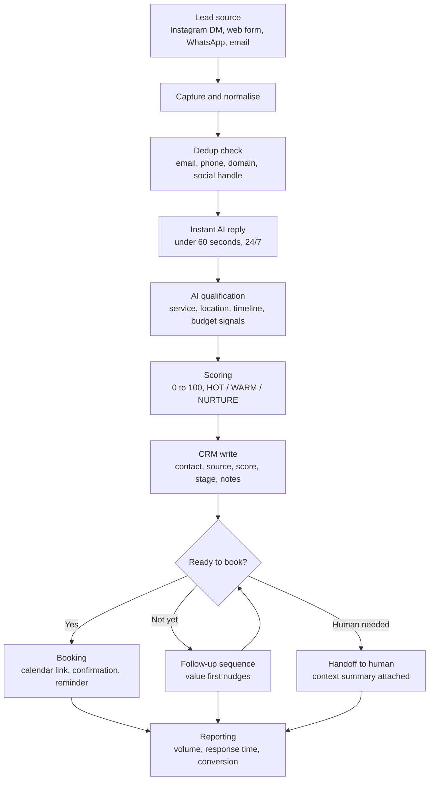

# Architecture and Data Model

Architecture for the AI Lead Automation pipeline described in the [README](../README.md): capture, instant reply, AI qualification, CRM write, follow-up, booking, and reporting.

This document is stack agnostic. It can be implemented with n8n or Zapier for orchestration, an LLM for reply and qualification, and the CRM and calendar a business already uses.

## Component diagram

## Components

| Component | Responsibility | Notes |
|---|---|---|
| Capture | Receive new inquiries from every channel and normalise them into one lead record | One entry point per channel, one shared record format |
| Dedup | Match a new inquiry against existing leads before creating anything | Keys and rules in [crm-field-mapping.md](crm-field-mapping.md) |
| Instant reply | First response in under 60 seconds, on brand, at any hour | Acknowledges the inquiry, names the service asked about, asks the first qualifying question |
| Qualification | A short conversation that extracts service, location, timeline, and budget signals | Patterns in [qualification-prompts.md](qualification-prompts.md) |
| Scoring | Convert qualification signals into a 0 to 100 score and a band | Deterministic rules first, LLM extraction second, see the scoring model below |
| CRM write | Create or update the contact, deal, and activity in the CRM | Field mappings in [crm-field-mapping.md](crm-field-mapping.md) |
| Follow-up | Scheduled, value first messages for leads that have not booked | Patterns and timing in [follow-up-patterns.md](follow-up-patterns.md) |
| Booking | Offer real availability, confirm the appointment, send reminders | Calendar is the source of truth for availability |
| Handoff | Pass hot, complex, or sensitive conversations to a person with context | Summary includes what was asked, what is known, and what was promised |
| Reporting | Volume, response time, qualification rate, booking rate, by channel | Read from the CRM, not from chat logs |

## Lead data model

One record per lead, regardless of the channel it arrived on.

| Field | Type | Description |
|---|---|---|
| `id` | string | Stable lead ID, assigned once at capture and never reused |
| `source_channel` | enum | Where the lead arrived: `instagram`, `web_form`, `whatsapp`, `email`, `other` |
| `contact` | object | Name, email, phone, and social handle, as provided. Any of these may be missing at capture |
| `service` | string | The service the lead asked about, in the business's own service list where possible |
| `location` | string | City or service area relevant to the job |
| `timeline` | string | When they want it done, in their words, plus a normalised urgency flag if clear |
| `score` | integer 0 to 100 | Lead score, see the scoring model below |
| `score_band` | enum | `HOT`, `WARM`, `NURTURE`, or below threshold |
| `stage` | enum | Pipeline stage, see below |
| `owner` | string | Person or team responsible for the next action. May be the automation itself for early stages |
| `last_interaction` | timestamp | Last message, call, or update in either direction |
| `next_action` | string | The single next step for this lead, written so a human can pick it up cold |
| `next_action_date` | date | When that next action is due |
| `notes` | text | Qualification summary and anything promised to the lead |

Rules for the model:

- Every active lead always has a `stage`, a `next_action`, and a `next_action_date`. A lead missing any of the three is a pipeline error, not a quiet lead.
- `contact` fields are only written when the lead actually provided them. Never guess an email or phone number.
- The original inquiry text stays attached to the record. Summaries support it, they do not replace it.

## Pipeline stages

| Stage | Meaning | Exit condition |
|---|---|---|
| New | Captured, first reply sent, qualification not yet complete | Qualification finishes or times out |
| Qualified | Scoring done, band assigned, record complete in the CRM | Booking offered, follow-up starts, or handoff |
| Warm | In follow-up, engaged or expected to engage, not yet booked | Books, goes cold, or opts out |
| Discovery | Human conversation or call in progress | Outcome known |
| Proposal | A specific offer is with the lead | Accepted, declined, or stale |
| Negotiation | Terms being discussed with a human owner | Won or lost |
| Won | Became a client or a confirmed booking | Closed out |
| Lost | Declined, unresponsive after the full sequence, or opted out | Reactivation window only, see [follow-up-patterns.md](follow-up-patterns.md) |

## Lead scoring model (0 to 100)

The same model as the README. Apply it after qualification, and re-score when new signals arrive.

| Signal | Points |
|---|---|
| Clear problem stated | 20 |
| Service fit | 20 |
| Potential value | 15 |
| Business size | 10 |
| Ability to pay | 10 |
| Decision-maker access | 10 |
| Urgency | 10 |
| Recent activity | 5 |

Bands: **HOT 80+**, **WARM 65 to 79**, **NURTURE 50 to 64**. Below 50, the lead stays in the CRM with a reactivation date rather than consuming follow-up effort.

Scoring notes:

- Score only on evidence from the conversation or the source channel. Missing information scores zero for that signal, it is never assumed.
- HOT leads are offered booking immediately and flagged to a human the same day.
- The score is a prioritisation tool for the team. It is never quoted to the lead.

## Failure handling

### After hours

The pipeline does not sleep. Capture, instant reply, qualification, and CRM write run the same at 10pm as at 10am. What changes after hours is the human side: handoffs queue for the next working period with the full context attached, and booking offers real calendar availability rather than promising a person will call back at a specific time.

### No reply

If a lead stops replying during qualification, do not restart the conversation. The record keeps what is already known, the stage moves to Warm when appropriate, and the follow-up sequence in [follow-up-patterns.md](follow-up-patterns.md) takes over with its timing ladder and its stop rules.

### Handoff to human

Hand off immediately, with a context summary, when any of these happen:

- The lead asks for a person
- The lead is HOT (80+) and ready to talk or book
- Pricing, contract, or anything outside the standard offer is requested
- The lead is unhappy, confused, or correcting the automation
- Qualification cannot extract what is needed after a reasonable exchange
- Anything was promised that a human needs to approve or deliver

The summary attached to a handoff states: who the lead is, what they asked for, score and band, stage, what the automation already said, and what was promised. A human should never need to re-read the whole thread to act.

### System errors

- A failed CRM write is retried once. If it fails again, the lead record is held in the orchestration tool and flagged for review rather than being lost or duplicated.
- A failed message send is never retried blindly. Check whether it landed first, then decide.
- Dedup runs before every create. When in doubt, update the existing record instead of creating a second one.

## Reporting

Report from CRM data, on a regular cadence:

- New leads by channel
- Median first response time
- Qualification completion rate
- Booking rate for HOT, WARM, and NURTURE bands separately
- Follow-up reply rate
- Handoffs and their outcomes

If a number is not tracked yet, report it as not tracked. Never estimate a metric and present it as measured.
